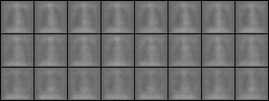
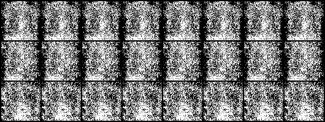
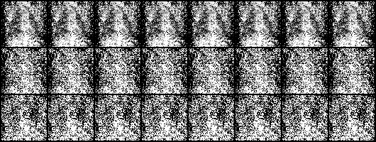
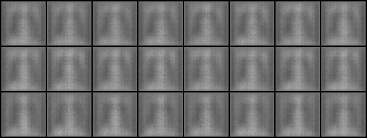
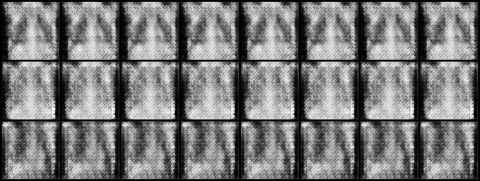
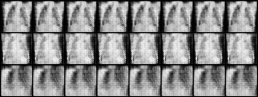
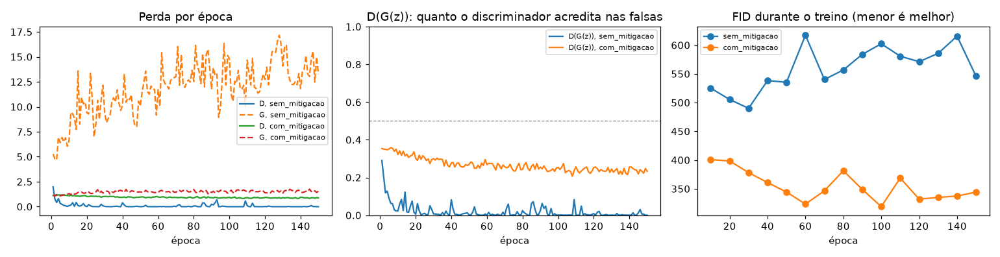
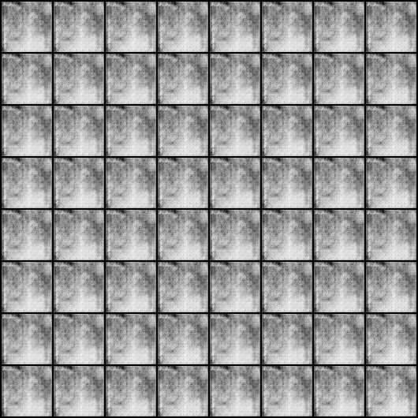
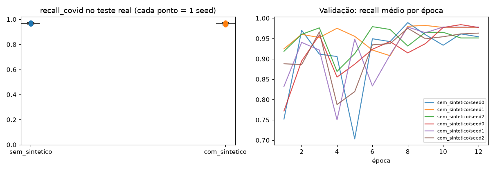
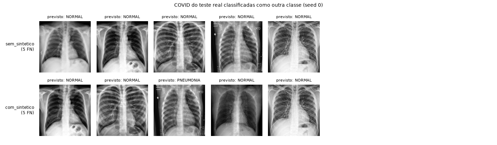

# A4.1: detecção de COVID-19 em raio-X de tórax

> Gerado por `scripts/run_a4.py` (`make run-a4`) a partir de `outputs/20261012-222622-a4/` (commit `1570d30`, com alterações ainda não commitadas, dispositivo `mps`). Não edite à mão: todo número abaixo é lido dos arquivos de resultado.

## Problema

Um grupo treinou um classificador de raio-X em três classes (Normal, Pneumonia, COVID-19) e reportou 93% de accuracy de treino e 61% de validação; o time clínico disse que o modelo "ignora casos positivos". Esta atividade faz três coisas: aponta os problemas técnicos do projeto, gera raio-X de COVID com uma GAN condicional para atacar a falta de exemplos, e mede, num teste só com imagens reais, se o recall da COVID melhora com as imagens geradas.

## Dados: o caso remontado

Fonte: Kaggle `sachinkumar413/covid-pneumonia-normal-chest-xray-images`, versão 1, sha256 do .zip `8e6839f126d9…`, 5228 arquivos.

1. **Cópias removidas antes de qualquer split.** O hash perceptual (pHash de 64 bits) achou 487 grupos de cópias: 1092 imagens repetidas saíram, e 6 imagens de 3 grupos com rótulos diferentes foram descartadas (não dá para saber qual rótulo é o certo). De 5228 imagens sobraram 4130 (21,0% eram cópias ou conflitos). Duas imagens contam como cópia quando a distância de Hamming entre os hashes é no máximo 2.
2. **Teste real separado primeiro**: 150 imagens por classe, nunca vistas pela GAN nem pelo classificador. O teste é balanceado; o recall de cada classe não depende da proporção do teste, e a precisão da COVID é recalculada na prevalência do caso.
3. **O caso do PD sorteado do resto** (seed 42), com 20% estratificados para validação.

| Parte | NORMAL | PNEUMONIA | COVID | Total |
|---|---|---|---|---|
| treino | 672 | 192 | 96 | 960 |
| validação | 168 | 48 | 24 | 240 |
| teste real | 150 | 150 | 150 | 450 |

## Problemas do projeto anterior

Cada problema traz o que estava errado, por que isso distorce o resultado e o impacto clínico esperado. Os números vêm do enunciado (PD) ou deste experimento.

### 1. Accuracy global como única métrica

Com 70% das imagens na classe Normal (840 de 1200), um modelo que responde sempre "Normal" tem 70% de accuracy, mais que os 61% reportados na validação, e recall zero para COVID. A accuracy mistura as classes e esconde justamente o erro que importa. Nour & Tariq (2023) acharam recall abaixo de 60% para COVID em modelos com accuracy alta.

**Impacto clínico:** o hospital recebe um número que parece aceitável enquanto os casos positivos passam como negativos. É o que o time clínico relatou: o modelo "ignora casos positivos".

### 2. Desbalanceamento não tratado

COVID é 10% do conjunto (120 de 1200). Sem class weights, reamostragem ou augmentation dirigida, a perda é dominada pela classe Normal e o modelo aprende que errar COVID custa pouco.

**Impacto clínico:** falsos negativos de COVID. Um paciente infectado classificado como normal pode ser liberado sem isolamento nem tratamento, e transmitir o vírus.

### 3. Divisão 80/20 sem estratificação e sem teste separado

Sem estratificar, a validação de 240 imagens tem em média 24 COVID, mas o sorteio pode dar de 16 a 32 (intervalo de 95%, distribuição hipergeométrica). O recall da COVID passa a depender da sorte do sorteio. E a mesma validação serviu para acompanhar o treino e para reportar o resultado: não há teste intocado, então o número final é otimista.

**Impacto clínico:** a sensibilidade prometida não se repete no uso real. Uma decisão de implantar tomada com esse número expõe pacientes a um modelo pior do que o anunciado.

### 4. ResNet-18 sem pré-treino em 1.200 imagens: overfitting

Treinar 11 milhões de parâmetros do zero com 1.200 imagens leva à memorização: 93% de accuracy no treino contra 61% na validação, uma distância de 32 pontos. O modelo aprendeu detalhes das imagens de treino, não padrões de doença. Pesos pré-treinados (ImageNet ou, melhor, raio-X) dão características gerais prontas.

**Impacto clínico:** o desempenho cai em imagens novas, de outro aparelho ou de outro hospital. O modelo fica instável justamente fora do ambiente em que foi testado.

### 5. Nenhuma augmentation

Sem rotação, escala, brilho ou contraste, a rede só vê cada raio-X de um jeito. Ela fica sensível a posicionamento do paciente, exposição e equipamento, e a classe rara continua com só 120 exemplos.

**Impacto clínico:** um raio-X portátil (leito, AP) ou com exposição diferente pode ser classificado errado. Esses são justamente os pacientes mais graves.

### 6. Otimização sem critério: SGD, lr fixo de 0,01, 15 épocas

Learning rate fixo e alto, sem agenda, sem early stopping e sem escolher a época pela validação: o resultado é o da época 15, seja ela boa ou não. Não há curva de treino nem repetição com outra seed para saber se o número é estável.

**Impacto clínico:** o modelo não é reprodutível. Retreinar pode dar outro resultado, e o hospital não tem como confiar que a versão implantada é a medida.

### 7. Cópias no dataset e risco de vazamento

Neste dataset público, 21,0% das imagens eram cópias ou quase-cópias (1092 repetidas e 6 com rótulos em conflito). Sem dedup, a mesma radiografia cai no treino e na validação, e a validação mede memória, não generalização. O projeto não fala de dedup nem de separar por paciente.

**Impacto clínico:** desempenho superestimado. Imagens com rótulos em conflito também ensinam o modelo errado.

### 8. Resultado único, sem intervalo e sem ponto de operação

Um único treino e uma única accuracy, sem intervalo de confiança, matriz de confusão ou limiar escolhido para triagem. Em triagem, o limiar deve ser ajustado para alta sensibilidade, aceitando mais falsos positivos.

**Impacto clínico:** "promissor" sem intervalo pode ser ruído. E sem ponto de operação definido, não se sabe quantos positivos o sistema deixa passar por cada 100 casos.

## GAN condicional

DCGAN condicional em 64 x 64, em tons de cinza, treinada só com o treino do caso (960 imagens, as três classes). O gerador recebe ruído z (100 números) concatenado a um embedding da classe e sobe a resolução com convoluções transpostas até 64 x 64, com `tanh` no fim. O discriminador recebe a imagem e um mapa da classe (embedding do rótulo do tamanho da imagem) como segundo canal, e devolve um logit (real ou falsa). Sem max pooling; pesos iniciados como no artigo da DCGAN (aula 07).

**Loop adversarial**, por lote:

1. Passo do discriminador: imagens reais com o rótulo certo têm alvo "real", imagens geradas (com rótulos sorteados) têm alvo "falsa". Só os pesos do discriminador mudam; a imagem gerada entra desligada do grafo do gerador.
2. Passo do gerador: as mesmas imagens geradas passam pelo discriminador com alvo "real" (perda não saturante, aula 07). Só os pesos do gerador mudam.

Adam com lr 0,0002 e betas (0,5; 0,999), lote 64, 150 épocas. Os testes `test_a4.py` conferem que cada passo muda só a sua rede e que o loop alterna D e G.

| Variante | Passos de D | Passos de G | Tempo (s) |
|---|---|---|---|
| sem_mitigacao | 2250 | 2250 | 630 |
| com_mitigacao | 2250 | 2250 | 661 |

Amostras com o mesmo z ao longo do treino (uma linha por classe: NORMAL, PNEUMONIA, COVID):

## Instabilidade e mitigação

Treinamos a mesma GAN duas vezes: sem mitigação e com label smoothing (0.9), spectral norm no discriminador, replay buffer (512, p=0.5). As estratégias vêm da aula 07: rótulo 0,9 em vez de 1 (o discriminador fica menos confiante), spectral norm no discriminador (limita o quanto ele muda por passo) e replay buffer (o discriminador revê imagens falsas antigas e o gerador não consegue "pular" de um modo para outro).

Como medimos: FID entre 960 imagens geradas e as 960 reais do treino, na mesma resolução (64 px, Inception-v3 do ImageNet, aula 08), a cada 10 épocas. O FID se divide no termo da média (o gerado está deslocado do real?) e no termo da covariância (a variedade bate?). Para colapso de modo, medimos também a diversidade da COVID gerada: distância média entre pares de imagens geradas dividida pela mesma distância entre as reais (1 = mesma variedade; abaixo de 0,5 tratamos como colapso).

| Métrica | sem_mitigacao | com_mitigacao |
|---|---|---|
| FID final | 545,9 | 344,3 |
| Melhor FID (época) | 490,1 (30) | 318,9 (100) |
| Termo da média no melhor | 376,2 | 205,5 |
| Termo da covariância no melhor | 113,9 | 113,4 |
| FID só da COVID (reais x geradas) | 439,6 (n = 96 x 600) | 341,1 (n = 96 x 600) |
| Diversidade da COVID gerada | 0,16 | 0,11 |
| D(x) real, fim do treino | 1,00 | 0,67 |
| D(G(z)) falsa, fim do treino | 0,00 | 0,24 |
| Discriminador dominou | sim | não |
| FID subiu mais de 10% depois do melhor | sim | não |
| Colapso de modo | sim | sim |

**Diagnóstico.**

- **sem_mitigacao:** o discriminador dominou (D(x) = 1,00 e D(G(z)) = 0,00 no fim): o gerador recebe gradiente fraco, sinal de divergência; o FID piorou depois da época 30 (490,1 para 545,9): o treino não se sustentou; colapso de modo: a COVID gerada tem diversidade 0,16 da real.
- **com_mitigacao:** colapso de modo: a COVID gerada tem diversidade 0,11 da real; o discriminador não dominou (D(x) = 0,67 e D(G(z)) = 0,24 no fim): o gerador continua recebendo gradiente.

**Evidência.** A mitigação melhorou o FID: o melhor FID foi de 490,1 para 318,9 (-34,9%), e o FID final de 545,9 para 344,3. A mitigação estabilizou o jogo entre as redes, mas não resolveu o colapso de modo: a diversidade da COVID gerada foi de 0,16 para 0,11, e as imagens de uma mesma classe saem quase iguais mesmo com z diferente. Variante usada para gerar as COVID sintéticas: `com_mitigacao` (melhor checkpoint por FID).

Limites do FID aqui: a Inception foi treinada em fotos do ImageNet, não em raio-X, e o FID só da COVID usa poucas reais, então é enviesado para cima. Serve para comparar as duas variantes medidas do mesmo jeito, não como nota absoluta (aula 08).

## Recall da COVID com e sem sintético

Mesmo classificador nas duas condições: ResNet-18 pré-treinada no ImageNet, com class weights, augmentation leve (rotação, escala, translação, brilho e contraste), AdamW (lr 0,0003), 12 épocas, imagem 224 x 224, época escolhida pelo maior recall médio na validação. "Com sintético" soma 600 COVID geradas (64 x 64, redimensionadas) ao treino. As duas condições são avaliadas no mesmo teste real (150 COVID), em 3 seeds.

| Condição | Recall COVID: média | IC 95% | Mín. a máx. | Por seed | Recall médio (3 classes) | Precisão da COVID na prevalência do caso |
|---|---|---|---|---|---|---|
| sem_sintetico | 0,967 | 0,950 a 0,983 | 0,960 a 0,973 | 0,97, 0,97, 0,96 | 0,959 | 1,000 |
| com_sintetico | 0,964 | 0,939 a 0,990 | 0,953 a 0,973 | 0,97, 0,95, 0,97 | 0,960 | 0,995 |

Diferença pareada por seed (com menos sem): média -0,002, IC 95% de -0,044 a 0,039 (por seed: 0,000, -0,020, 0,013). Veredito: não dá para dizer que o sintético mudou o recall da COVID: o intervalo da diferença inclui o zero. Com 3 seeds, uma diferença desse tamanho pode ser ruído.

O intervalo usa a distribuição t com n = 3 seeds; ele mede a variação do treino, não a incerteza da amostra de teste. A precisão na prevalência do caso recalcula a precisão como se o teste tivesse 70% NORMAL, 20% PNEUMONIA, 10% COVID.

O classificador sem sintético já acerta 96,7% das COVID reais: sobra pouco espaço para o sintético ajudar (efeito teto). Isso contrasta com o projeto anterior, que "ignora casos positivos": com pré-treino, class weights, augmentation e dedup juntos o recall já é alto (este experimento não separa qual deles pesa mais).

Análise de erros: somando as 6 execuções, houve 31 COVID não reconhecidas, e 26 delas foram chamadas de Normal, não de Pneumonia. São possivelmente casos com pouco achado visível, em que a triagem por imagem é mais fraca. Abaixo, as da primeira seed.

## Plano de melhoria integrado

Cada problema da lista acima tem uma ação. O plano se organiza em dados, modelo, métrica, augmentation sintética e critério de adoção clínica.

| Problema | Ação |
|---|---|
| 1. Accuracy como única métrica | recall da COVID como métrica principal, matriz de confusão e recall por classe |
| 2. Desbalanceamento | class weights (já aplicado aqui) e sintético condicionado |
| 3. Split sem estratificação e sem teste | teste real separado primeiro; estratificação; o teste é usado uma vez |
| 4. Sem pré-treino, overfitting | ResNet-18 pré-treinada, fine-tuning, weight decay |
| 5. Sem augmentation | augmentation leve e plausível para raio-X |
| 6. Otimização sem critério | AdamW com agenda, escolha da época na validação, várias seeds |
| 7. Cópias e vazamento | dedup por pHash antes do split; split por paciente quando houver o identificador |
| 8. Resultado sem intervalo nem limiar | média e IC em seeds; limiar escolhido para sensibilidade |

### Dados e validação

Dedup por hash perceptual antes de qualquer split (aqui removeu 21,0% das imagens). Teste real separado primeiro e nunca usado para escolher nada. Quando houver identificador de paciente, separar por paciente. Validação externa com imagens de outro hospital antes de qualquer uso.

### Modelo

Partir de pesos pré-treinados (ImageNet, ou melhor, um modelo pré-treinado em raio-X de tórax) e fazer fine-tuning com AdamW, agenda de learning rate, weight decay e escolha da época pela validação, como aqui. Class weights na perda. Repetir em várias seeds e reportar média e intervalo. Como próximo passo, comparar com uma arquitetura maior (DenseNet-121, comum em raio-X) com o mesmo protocolo, e calibrar as probabilidades (temperature scaling) para que o limiar signifique algo.

### Métrica

Recall (sensibilidade) da COVID como métrica principal, porque o custo clínico é o falso negativo. Junto: recall por classe, matriz de confusão, recall médio das três classes e precisão da COVID na prevalência esperada no hospital (não na do teste). Todo número com intervalo. Escolher o limiar de decisão na validação para atingir a sensibilidade alvo, e reportar a especificidade que sobra.

### Augmentation sintética

GAN condicional treinada só com o treino, com mitigação de instabilidade (label smoothing, spectral norm, replay buffer) e escolha do checkpoint pelo FID (aqui o melhor FID foi 318,9). Três travas antes de usar: (1) FID e diversidade medidos e sem colapso de modo; (2) o teste fica 100% real; (3) o ganho no recall da COVID precisa ter intervalo acima de zero em várias seeds. Neste experimento a trava (1) falhou: a GAN escolhida colapsou (diversidade 0,11), então as COVID sintéticas são quase a mesma imagem repetida (veredito do recall: inconclusivo). O sintético não entra no pipeline até uma GAN passar pelas três travas. Próximos passos: atacar o colapso com minibatch discrimination (o discriminador compara as imagens do lote entre si) e learning rates diferentes para D e G; gerar em resolução maior (128 ou 256 px) para não ensinar ao classificador que "imagem borrada = COVID", revisar uma amostra das geradas com um radiologista e testar um modelo de difusão com o mesmo protocolo.

### Critério de adoção clínica

O modelo só vai para uso assistido (segunda leitura, nunca decisão sozinho) se, num teste externo real com a prevalência do hospital: (1) o recall da COVID for pelo menos 0,90 com o limite inferior do IC 95% acima de 0,85; (2) nenhuma classe tiver recall abaixo de 0,80; (3) a precisão da COVID na prevalência real for informada à equipe; (4) o resultado se mantiver num período silencioso (o modelo roda sem influenciar a conduta, comparado com o laudo). Depois, monitorar o recall por mês e retreinar quando cair. Hoje o recall médio da COVID no teste real é 0,967 sem sintético e 0,964 com sintético; o critério (1) é atingido no teste interno, o que ainda não dispensa o teste externo.

## Limites

- Uma execução de cada GAN (uma seed): a comparação sem e com mitigação não tem intervalo.
- O sintético é 64 x 64 redimensionado para 224: o classificador pode associar imagem borrada a COVID. O teste real mede o efeito final, mas não separa as causas.
- 3 seeds dão um intervalo largo; o teste tem 150 COVID, então cada imagem vale 0,0067 de recall.
- O dataset junta fontes diferentes por classe; o modelo pode aprender a fonte, não a doença. Só um teste externo responde isso.
